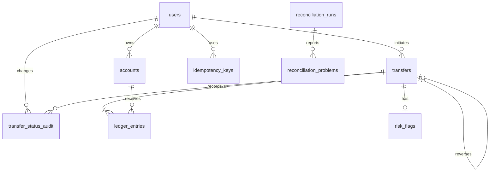

# Schema Design

## Noun Inventory

| Noun | Stored? | Reason |
| --- | --- | --- |
| User | Yes, `users` | Owns wallets and provides the user-controlled contact and KYC attributes. |
| Wallet | Yes, as a `USER_WALLET` row in `accounts` | Holds INR balance and belongs to one user. |
| System account | Yes, as a non-user row in `accounts` | Cash-in, cash-out, and fee revenue use the same ledger model as wallets. |
| Transfer | Yes, `transfers` | Captures a money movement, status, type, amount, and optional reversal link. |
| Ledger entry | Yes, `ledger_entries` | Immutable debit or credit line attached to one transfer and one account. |
| Idempotency key | Yes, `idempotency_keys` | Stores a per-user request hash and the first completed response. |
| Status change | Yes, `transfer_status_audit` | Retains the old/new status, actor, and timestamp. |
| Reconciliation run/problem | Yes, `reconciliation_runs` and `reconciliation_problems` | Persists nightly check results and individual mismatches. |
| Job lock | Yes, `job_locks` | Provides a row to lock while reconciliation runs. |
| Risk rule/flag | Yes, `risk_rules` and `risk_flags` | Stores configurable thresholds and transfer review/explanation data. |
| User API token | Yes, `user_api_tokens` | Stores a hash of the bearer credential and its revocation state; the raw token is returned only at user creation. |
| Statement question | No | Questions are transient requests; answers are computed from ledger rows. |
| Payment provider | No | The brief defines internal accounts, not provider integrations. |

## Cardinalities

- One user owns zero or many wallet accounts; every wallet belongs to exactly one user.
- System accounts have no user owner; each system account type has one row.
- One transfer has two or more ledger entries when completed; each ledger entry belongs to exactly one transfer.
- One account has zero or many ledger entries; each entry posts to exactly one account.
- One user has zero or many idempotency keys; a key is unique within that user.
- One user has zero or many API tokens; each token hash identifies exactly one user.
- One transfer has zero or many status audit rows; each audit row refers to one transfer.
- One reconciliation run has zero or many problems; each problem belongs to one run.
- One risk rule can flag many transfers; each stored risk flag refers to one transfer.
- One transfer can reverse at most one original transfer, and an original transfer can be reversed at most once.

## ER Diagram

## Money and Integrity Decisions

- All money uses positive whole paise in `BIGINT`; `direction` separately records `DEBIT` or `CREDIT`. No floating-point money is stored.
- Wallets and system accounts share `accounts` so every movement uses the same ledger and statement model. `account_type` and the owner constraint distinguish them; only wallet balances are constrained nonnegative.
- `accounts.balance_paise` is stored for fast balance reads and updated by a database trigger for every inserted ledger entry. The ledger remains the source of truth; nightly reconciliation must compare this cache against the ledger sum.
- A deferred constraint trigger checks completed transfers at commit: there must be at least two entries and debit and credit totals must each equal the transfer amount. Held/pending transfers have no postings until released.
- A database trigger rejects ledger entry updates and deletes. Corrections use a separate reversal transfer.
- Each POST stores a SHA-256 request hash and the exact serialized response text. A unique per-user key serializes concurrent retries; reusing the key with a different body is rejected.
- Stored idempotency response bodies are encrypted with AES-GCM; configure a persistent `IDEMPOTENCY_ENCRYPTION_KEY` to retain replay ability across application restarts.
- User-supplied email and phone are unique attributes, not primary keys: they can change and are controlled outside the database. Generated `BIGINT` IDs remain stable references.
- `ix_ledger_account_statement` supports an account statement ordered by `created_at DESC, id DESC`; it costs extra work on every ledger insert.
- The transfer transaction should use PostgreSQL Read Committed with explicit `SELECT ... FOR UPDATE` locks on all involved account rows in ascending ID order. The locks serialize balance checks and writes; Serializable would add abort/retry cost without replacing the need for deterministic locking.
- User, wallet, and transfer paths include `userId`, but the bearer-token filter verifies that it matches the token owner before reaching the controller. Admin routes use a separate development token and require a production identity provider before deployment.

## Migrations

`src/main/resources/db/migration/V1__create_wallet_ledger_schema.sql`, `V2__risk_reconciliation_and_held_postings.sql`, and `V3__user_api_tokens.sql` build this schema from an empty PostgreSQL database. The migrations target PostgreSQL 15 or later. Java's `model` package contains immutable records and enums; services use explicit `JdbcTemplate` SQL rather than ORM-managed entities.